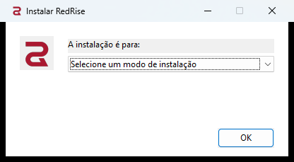
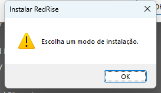
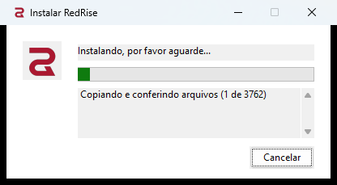
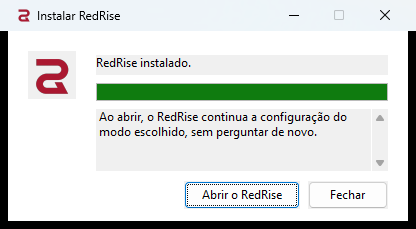
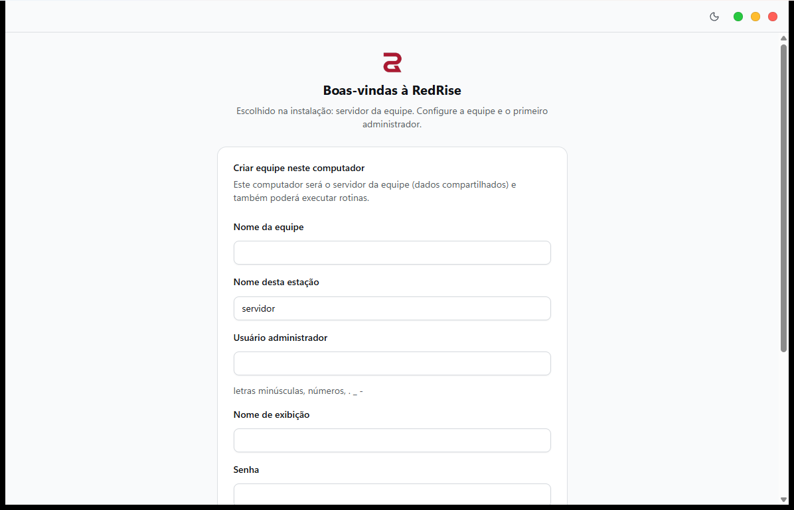
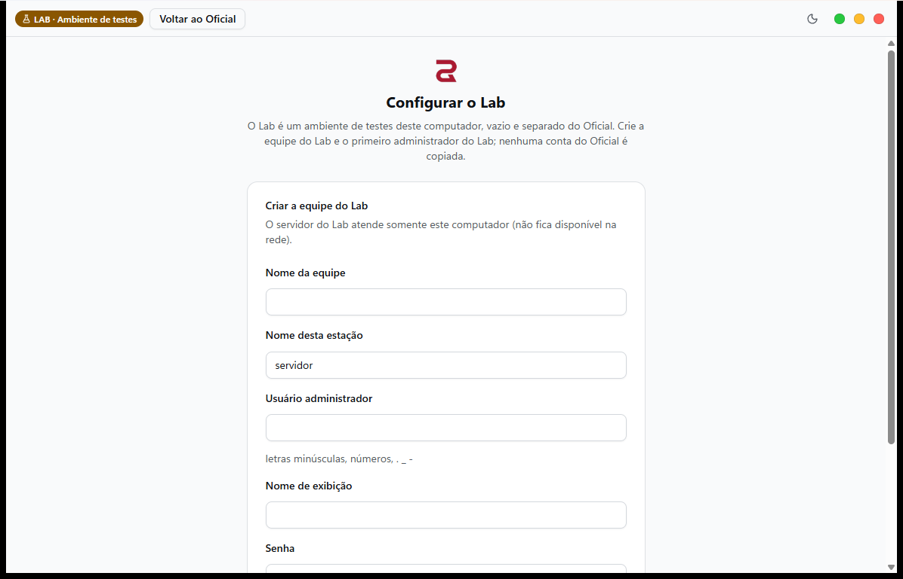
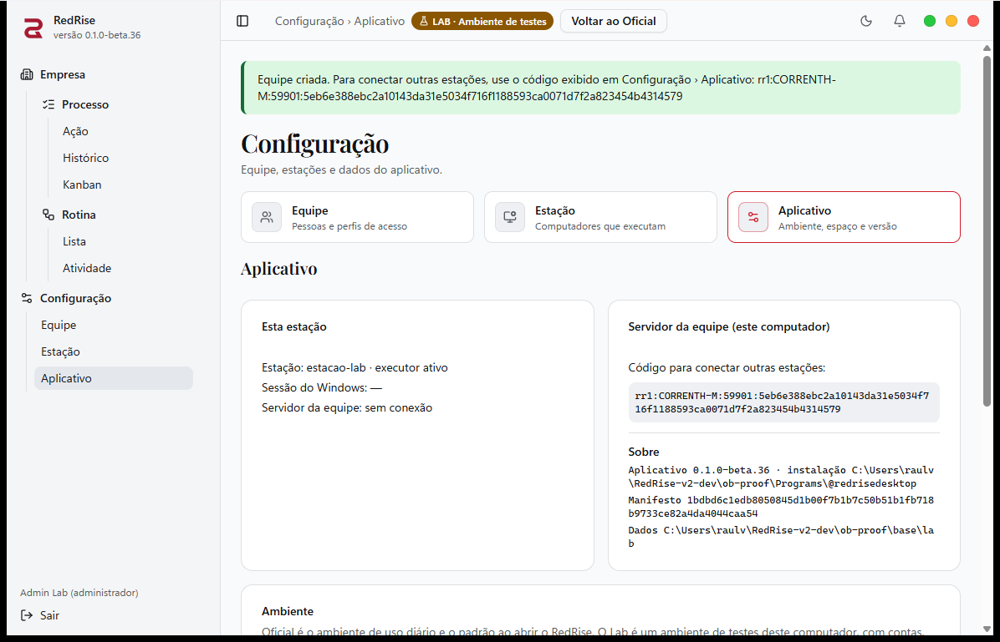
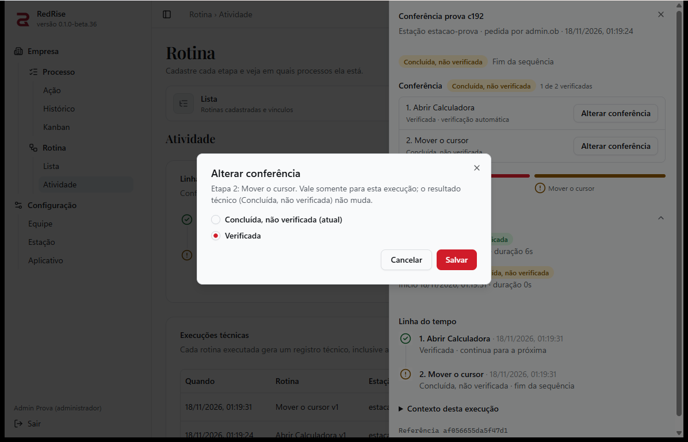

# Como instalar e usar o RedRise (Beta oficial) — Windows 11 x64

Este guia vale para o RedRise **0.1.0-beta.36** e versões seguintes do Beta oficial. As imagens usam uma equipe de teste com
dados fictícios.

Requisitos: Windows 11 64 bits, sua conta normal do Windows (não precisa ser administrador). Não é preciso instalar Python,
terminal ou qualquer outro programa: tudo vem dentro do instalador.

## 1. Baixar o instalador certo

1. Abra a página de versões: **https://github.com/correnth-ai/redrise-releases/releases/latest**.
2. Em **Assets**, baixe o arquivo **`redrise-desktop-0.1.0-beta.36-windows-x64.exe`** (o número muda nas próximas versões).
3. Confira se o arquivo é o publicado: na mesma página, o arquivo `SHA256SUMS.txt` traz o código SHA-256. No Windows, abra o
   PowerShell e rode `Get-FileHash .\redrise-desktop-0.1.0-beta.36-windows-x64.exe` na pasta do download: o resultado deve ser
   igual ao da página. (Passo opcional, para quem quiser conferir.)

> O instalador ainda não tem assinatura de código da Microsoft (Authenticode). O Windows pode mostrar
> "O Windows protegeu o computador". Só continue se o arquivo veio da página acima e o código confere. Não desative o
> antivírus nem a proteção do Windows.

## 2. Instalar: escolher Servidor ou Operação

Dê dois cliques no instalador. Uma janela pequena pergunta **"A instalação é para:"**.

- **Servidor**: este computador guarda os dados da equipe (banco de dados próprio) e também executa rotinas. Ele precisa ficar
  ligado, com o RedRise aberto, para atender as estações e os agendamentos.
- **Operação**: este computador se conecta ao servidor de uma equipe que já existe. Não cria outro banco nem outra equipe.

Se você clicar em **OK** sem escolher, aparece **"Escolha um modo de instalação."** — clique em OK nesse aviso e escolha.

Depois de escolher e clicar em **OK**, a mesma janela mostra **"Instalando, por favor aguarde..."** com o progresso real.
Você pode **Cancelar** até a troca de versão; nada fica instalado pela metade.

No fim, clique em **Abrir o RedRise**.

O RedRise fica em `%LOCALAPPDATA%\Programs\@redrisedesktop\RedRise.exe` e no menu Iniciar como **RedRise**. Seus dados ficam
separados, em `%LOCALAPPDATA%\RedRiseDesktop`.

## 3. Primeira abertura

### No computador Servidor

Preencha **Criar equipe neste computador**: nome da equipe, nome desta estação, o usuário e a senha do **primeiro
administrador** (não existe login de fábrica) e a porta na rede local. Na primeira vez o Windows pode perguntar se o RedRise
pode usar a rede: permita somente em redes privadas, se for usar estações em outros computadores.

A equipe começa **vazia**: sem rotinas, processos ou histórico. Em **Configuração › Aplicativo** aparece o código para
conectar outras estações.

### No computador de Operação

Use **Conectar a uma equipe**: cole o código da equipe (copiado do servidor), dê um nome a esta estação e entre uma vez com
um administrador da equipe para registrá-la. Depois disso, cada pessoa entra com a própria conta.

## 4. Entrar

Abra o RedRise pelo menu Iniciar. A janela aparece quando a tela de entrada está pronta (no computador de referência, em menos
de 20 segundos). Entre com seu e-mail ou usuário e senha.

## 5. Ambientes: Oficial e Lab

O RedRise sempre abre no **Oficial**, o ambiente de uso diário. O **Lab** é um ambiente de testes deste computador, com contas,
rotinas, processos e histórico próprios.

- Em **Configuração › Aplicativo › Ambiente**, um **administrador** escolhe **Lab** e clica em **Trocar de ambiente**. A sessão
  atual termina; na primeira vez, o Lab pede a sua própria equipe e o seu primeiro administrador (nada do Oficial é copiado).
- Um **operador** vê o botão bloqueado, com a mensagem "Somente administradores podem trocar de ambiente.".
- No Lab, o topo mostra **LAB · Ambiente de testes** e o botão **Voltar ao Oficial** (também só para administradores).
- Fechar e abrir o RedRise sempre volta ao Oficial.

> Os dados do RedRise ficam separados entre Oficial e Lab, mas as rotinas do Lab usam os mesmos programas e arquivos reais do
> Windows. Use destinos de teste no Lab.

Se houver execução ou gravação em andamento, a troca espera. Num servidor com outras estações conectadas, a troca é recusada
para não parar o servidor delas.

## 6. Conferência das execuções

Em **Rotina › Atividade**, abra uma execução. Cada etapa concluída mostra a sua conferência e o botão **Alterar conferência**:
administradores e operadores podem marcar **Verificada** ou voltar para **Concluída, não verificada**. Isso vale só para aquela
execução e não muda o resultado técnico. Quem alterou, em qual estação e quando aparece na **Atividade recente**.

Em **Processo › Ação**, a coluna **Status** mostra a última execução de cada processo: **Verificada** só quando todas as etapas
estão verificadas (ex.: "10 de 10 verificadas"); **Concluída, não verificada** quando todas terminaram e alguma falta conferir;
**Pendente** quando não terminou, falhou ou não foi executada. No **Kanban**, só a execução totalmente conferida vai para
**Conferido**.

## 7. Atualizar

Quando houver versão nova, o RedRise mostra **Nova versão disponível**. Clique em **Pode atualizar** quando não houver
execuções em andamento. O RedRise baixa a versão do canal oficial, confere a assinatura e o tamanho/SHA-256, fecha, instala e
abre de novo. Os dados do Oficial e do Lab são mantidos. Você também pode baixar o instalador novo da página de versões e
executá-lo: num computador já configurado ele não pergunta o modo de novo.

## 8. Recuperação

- **Voltar para a versão anterior**: a atualização guarda a versão anterior em `%LOCALAPPDATA%\Programs\@redrisedesktop.previous`.
  Com o RedRise fechado, rode `%LOCALAPPDATA%\Programs\@redrisedesktop\uninstall.exe --rollback`. Use somente se a versão nova
  não abrir; uma versão anterior não deve abrir um banco já migrado por uma versão nova sem orientação do suporte.
- **Desinstalar**: Configurações do Windows › Aplicativos › RedRise › Desinstalar. Os dados em `%LOCALAPPDATA%\RedRiseDesktop`
  são mantidos.
- Mensagens de erro do RedRise terminam com um **Código** e **Módulos**: copie a mensagem completa ao pedir suporte.

## Limitações deste Beta

- Somente Windows 11 x64, testado num computador de referência; outros monitores/escalas de tela não foram homologados.
- Sem assinatura Authenticode (o Windows pode avisar).
- Equipe em rede (outra estação) não foi testada nesta versão.
- O navegador interno do RedRise (Chromium do Playwright 1.63) não acompanha as atualizações do seu navegador: para sites,
  prefira rotinas com o navegador instalado no computador.
